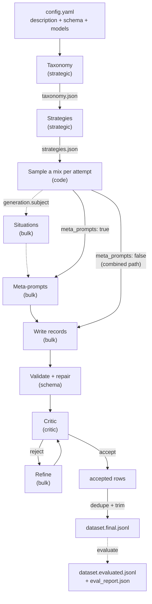

# How a run works

One YAML config drives everything. From a plain-English **description** and an optional **schema**,
`simula` first maps the space of things to generate (the **taxonomy**) and decides how to sample it
(the **strategies**). Then, for every record, code draws a **mix** (one node per factor), a model
writes the record from it, and a critic checks it before it is accepted. Every step writes a
readable file as it goes.



## The stages

`simula generate` (and `simula run`, which adds evaluation) goes through these in order.

1. **Taxonomy.** The `strategic` model discovers the factors of variation (or takes yours) and grows
   each into a tree. Written to `taxonomy.json`. See [Taxonomy](taxonomy.md).
2. **Subject.** With `generation.subject: auto`, the `strategic` model picks which factor says what a
   record is about, once, and stores the pick in `taxonomy.json`.
3. **Strategies.** The `strategic` model drafts a few weighted sampling strategies over the tree.
   Written to `strategies.json`. `generate` then simulates 5,000 draws and warns if a strategy pulls a
   factor away from its tree weights. See [Strategies and sampling](sampling.md).
4. **Situations** (when `generation.subject` is set). For every node of the subject factor, the `bulk`
   model lists one concrete situation per record that will use it. Written to `situations.jsonl`.
5. **Meta-prompts** (when `generation.meta_prompts` is true, the default). For every attempt, the
   `bulk` model writes a short instruction from the attempt's mix. Written to `meta_prompts.jsonl`.
   See [Situations and meta-prompts](situations-and-meta-prompts.md).
6. **Records.** The `bulk` model writes each record, from its meta-prompt or, on the combined path,
   straight from its mix, `record_batch_size` records per call. A share of attempts
   (`complexity_ratio`) is made harder by a separate `complexify` call.
7. **Validation and repair.** In JSON mode each record is checked against the schema. A record that
   fails is sent back once for repair and rejected if it still fails.
8. **Critique and refine.** The `critic` model accepts or rejects each record with an explanation. A
   rejected record is refined by `bulk` and critiqued again, up to `max_refine_attempts` times. When the
   critic returns a corrected record itself, a schema-valid correction is accepted with no refine call.
9. **Writing.** Rows are appended to `dataset.raw.jsonl` and `dataset.accepted.jsonl` as each attempt
   finishes, and `run_state.json` is checkpointed.
10. **Dedupe and trim.** Accepted rows are deduplicated (if `evaluation.dedupe` is on) and trimmed to
    `target_size`, keeping rows that add taxonomy coverage first, then the earliest attempts. The result
    is `dataset.final.jsonl`.

Evaluation is a separate step: `simula evaluate` (or the second half of `simula run`) reads
`dataset.final.jsonl` and never rewrites it. See [Evaluation](evaluation.md).

## Attempts

The number of records the run tries to make is fixed up front:

```text
attempts = ceil(target_size × overgenerate_ratio)
```

Each attempt produces exactly one record, with its own mix as lineage. The extra attempts are a buffer
for rows the schema or the critic rejects, so the accepted pool is usually larger than `target_size`
and the trim brings it back down. If too many attempts are rejected, `dataset.final.jsonl` comes out
short; raise `overgenerate_ratio`.

## Stop, edit, continue

The first stages write files that are reused when present: `taxonomy.json`, `strategies.json`,
`situations.jsonl` and `meta_prompts.jsonl`. That lets you stop after a stage, edit its file and carry
on from your edit:

```bash
simula generate my_config.yaml --stop-after taxonomy     # build the tree, then stop
# edit runs/my_run/taxonomy.json
simula generate my_config.yaml --stop-after strategies   # reuses your tree, builds strategies, stops
# edit runs/my_run/strategies.json
simula generate my_config.yaml                           # reuses both, writes the records
```

To rebuild a stage instead, delete its file and rerun. [Reviewing the design before you pay](../guides/reviewing-the-design.md)
covers what to look for at each stop.

## Resume

A rerun of `generate` or `run` resumes by default: attempts already in `dataset.raw.jsonl` are skipped,
so a stopped or crashed run only redoes what is missing. You can raise `target_size` and rerun to grow a
dataset.

`run_state.json` holds a fingerprint of everything that decides what an attempt produces: the
description, schema, seed, models, prompts, sampling, taxonomy, strategies and the per-attempt
generation knobs. If any of these changed, resume refuses rather than mixing old and new rows, and
asks for `--no-resume`. `target_size`, `overgenerate_ratio`, `trim`, `concurrency` and
`checkpoint_every` can change freely.

## Concurrency

Calls run concurrently, up to `generation.concurrency` in flight at once. Failed calls are retried with
backoff when the failure is transient (timeouts, 5xx, 408/409/429, honouring `Retry-After`), and fail
fast otherwise. An attempt whose calls fail for good is written as a rejected row with its reason,
instead of stopping the run. If the provider rate-limits, lower `concurrency`.
