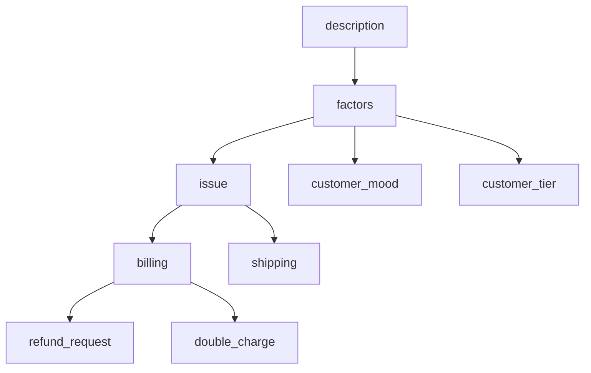

# Taxonomy

The taxonomy is a tree of the **factors of variation** your dataset should cover. For a
customer-support dataset the factors might be `issue`, `customer_mood` and `customer_tier`; each one
is grown into child categories down to `taxonomy.depth` levels.



## Why it exists

Asking a model for N records from one prompt gives N variations of the same few things: the model
keeps returning its most typical answer. The taxonomy is the coordinate system that forces coverage.
Every record is built from one node per factor (its **mix**), drawn by code, and that lineage is saved
on the row so you can check the spread afterwards.

## How it is built

The `strategic` model builds the tree breadth-first, one level at a time:

1. **Factors.** With `taxonomy.factors: null` the model reads the description and proposes 3–6
   factors. To fix them yourself, list them:

   ```yaml
   taxonomy:
     factors:
       - {name: issue, description: "What the customer needs help with"}
       - {name: customer_mood, description: "How the customer feels when writing"}
       - {name: customer_tier, description: "Free, paid or enterprise account"}
   ```

2. **Expansion.** Every node at the current level is expanded in parallel. The model drafts
   `best_of_n` candidate lists of about `children_per_node` children each.
3. **Critique.** With `taxonomy.critic` on (the default), a second call merges the candidates, adds
   children the node's description implies and drops duplicates.
4. **Next level.** While depth remains, the model writes one plan for how every node at the new level
   should be split, so sibling branches come out comparable, and the process repeats.

Each expanded node costs `best_of_n + 1` calls (one with `critic: false`).

## Size compounds

`children_per_node` is requested at every level, so a factor ends up with roughly
`children_per_node ^ depth` leaves. The default, `depth: 2` with 4 children, gives about 16 leaves per
factor; `depth: 4` with 4 children gives about 256, and many more `strategic` calls. For deep trees,
lower `children_per_node` (the e-commerce example uses depth 4 with 3 children). Build the tree once:
it is reused by every later run in the same `output_dir`.

## The file

`taxonomy.json` holds the description, the factors, and with `generation.subject: auto` the subject
pick:

```json
{
  "description": "Natural-language shopper searches turned into structured extractions...",
  "factors": [
    {
      "name": "product_vertical",
      "description": "The broad retail vertical the shopper is searching in",
      "level": 0,
      "children": [
        {
          "name": "apparel",
          "description": "Clothing, underwear and accessories",
          "level": 1,
          "path": ["product_vertical", "apparel"],
          "weight": 2.0,
          "children": []
        }
      ]
    }
  ],
  "subject": "product_vertical"
}
```

## Weights

Each node can carry a `weight`. Sampling walks down the tree choosing among siblings in proportion to
their weights, so weights set the dataset's shares. A node without a `weight` counts as `1.0`; `0`
switches a branch off. A branch's share comes only from weights, never from how many children the
builder happened to give it. See [Strategies and sampling](sampling.md).

## Reviewing and editing it

`taxonomy.json` is meant to be read and edited before you pay for records: rename nodes, delete ones
that do not belong, add missing ones, set weights. Three ways to get a stop to do that:

- `simula generate CONFIG.yaml --stop-after taxonomy` builds the tree and stops (recommended).
- `taxonomy.review_mode: write_then_edit` writes the tree and halts every time it is built.
- `taxonomy.review_mode: interactive_confirm` prints the tree and asks yes or no.

Rerun `generate` and it reuses your edited file. Some care when editing:

- When you add a node, copy a sibling's shape and set its `name`, `description`, `level` and `path`.
- Node names must not contain `/`, which separates path segments in strategies.
- Edit the tree before strategies are built, or delete `strategies.json` afterwards so they are
  rebuilt against the new tree.
- Running `simula taxonomy` again builds a new tree and overwrites your edits.

[Reviewing the design before you pay](../guides/reviewing-the-design.md) covers what to look for.
